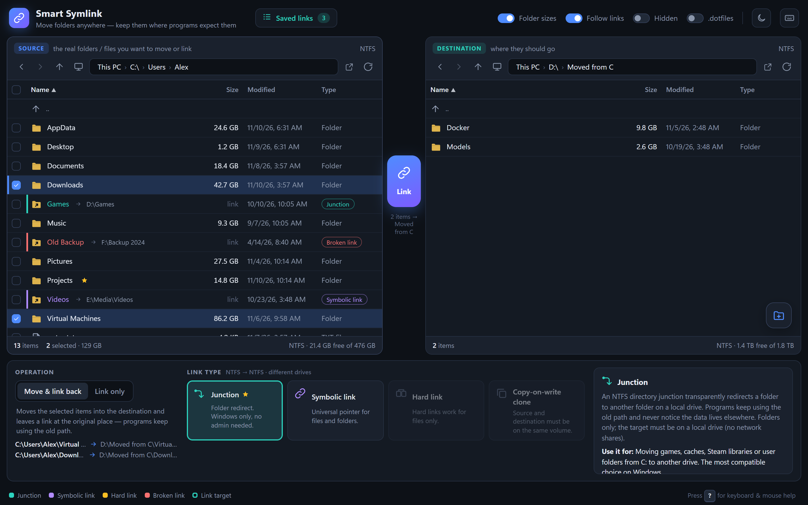
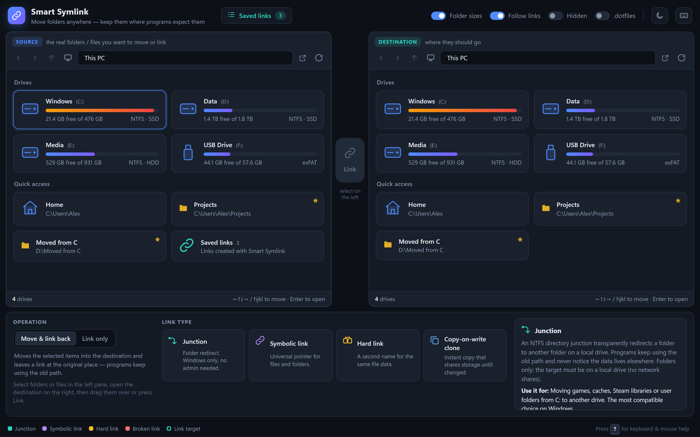
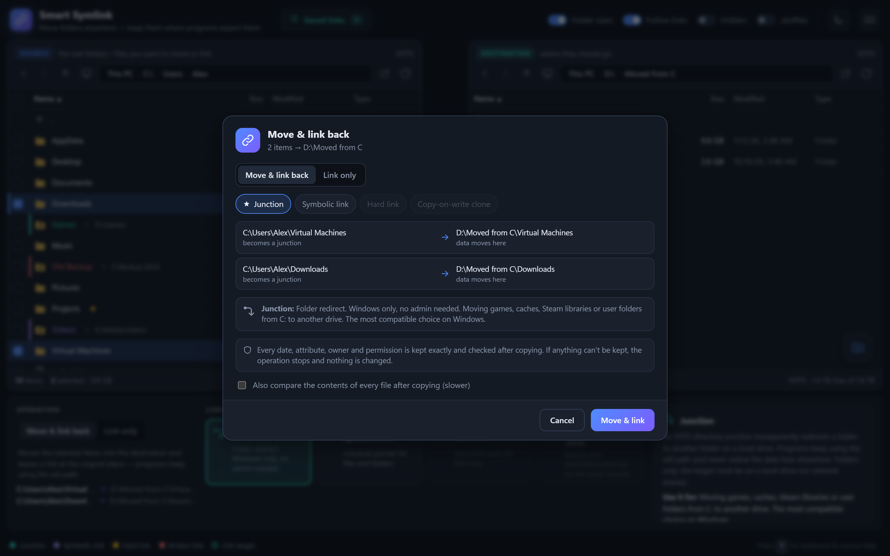
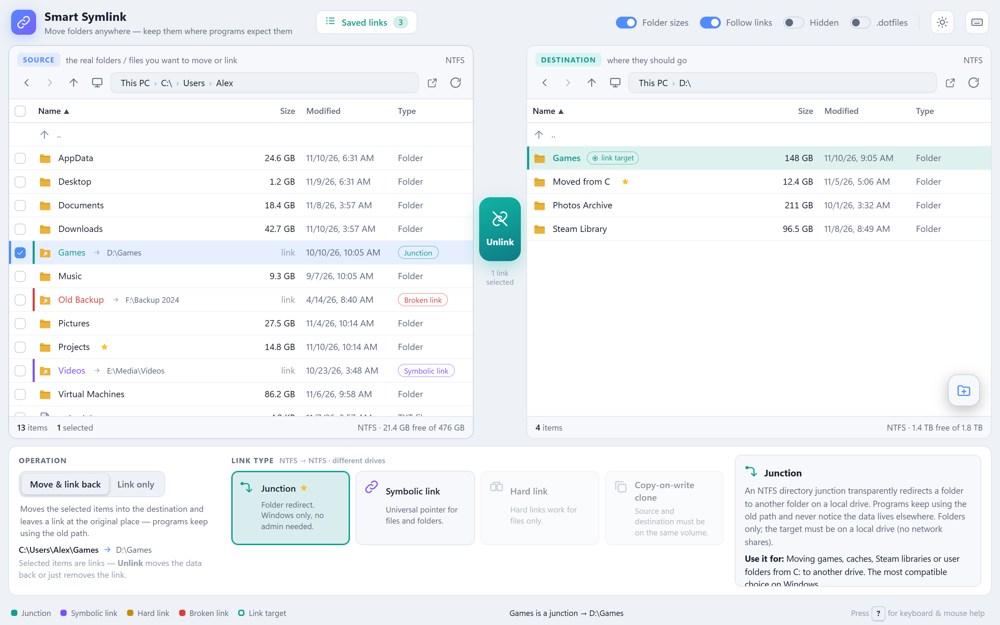
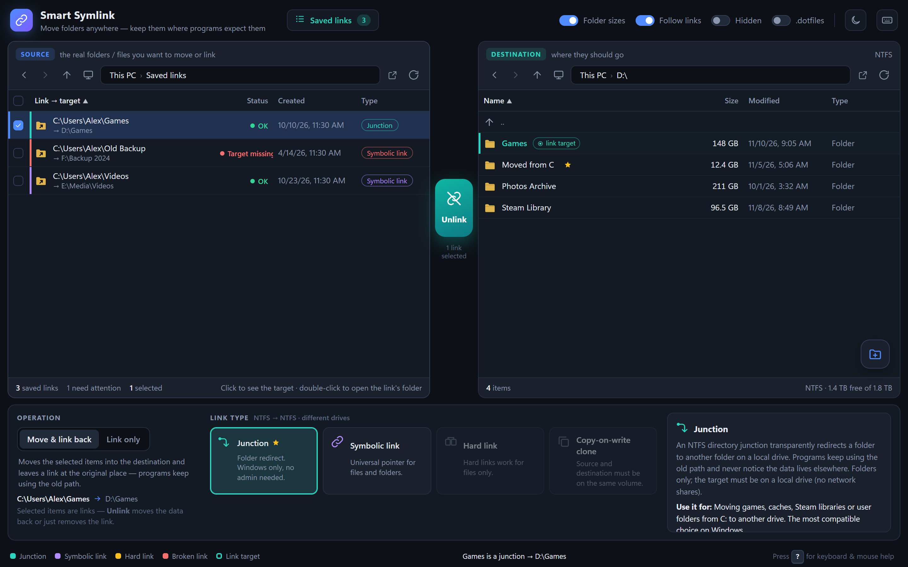

<p align="center">
  
</p>

<h1 align="center">Smart Symlink</h1>

<p align="center">
  <b>Move a folder to another drive and leave a link behind, so every program keeps working.</b><br>
  A small dual-pane app for Windows, Linux and macOS, plus a keyboard-driven terminal version.
</p>

<p align="center">
  
  
  
</p>



## Why

Your system drive is full, but the big folders on it (games, virtual machines, caches, downloads) are
exactly where programs expect them. Smart Symlink moves such a folder to another drive and puts a link at
the old path. `C:\Users\you\Games` still opens as before, while the data now lives on `D:\Games`.

Doing this by hand means copying, checking, deleting and typing `mklink` in an admin prompt. Smart Symlink
does it in one step, checks the result, and rolls back if anything goes wrong.

## Features

- **Two panes, like an FTP client.** Source on the left, destination on the right. Both start at
  *This Computer* with every drive, its size and its free space.
- **Move & link back, or link only.** Select folders or files, then drag them to the right pane or press
  **Link**. Multi-select works.
- **Every link type your system supports**, with a plain explanation of each. Types that can't be used
  for the current selection are greyed out and say why.
- **Links are easy to spot.** Junctions, symbolic links, hard links and broken links each have their own
  color. Click a link on the left and the right pane shows the folder it points to.
- **Unlink.** Moves the data back to where it was, or just removes the link. If moving back fails, the
  link is put back.
- **Re-link.** Move the data behind an existing link to another folder, or change the link type, while
  the link itself stays where it is.
- **Saved links.** Every link made with the app is kept in a list, with a status: OK, target missing,
  link missing or changed.
- **Nothing about your files changes.** Dates, attributes, owners, permissions, alternate data streams
  and hard links are kept and checked after copying ([details](#nothing-about-your-files-changes)).
- **Folder sizes** calculated in the background, sortable columns, hidden files and dotfiles toggles.
- **File basics** in the right-click menu: rename, delete (with confirmation), move, new folder,
  properties, open in the system file manager.
- **Quick Access** for folders you use often, light and dark themes, full keyboard control.
- **Small.** The app is about 3 MB and the terminal version is under 1 MB.

| | |
|---|---|
|  |  |
| Drives with free space, and Quick Access | Shows exactly what will happen before it starts |
|  |  |
| Select a link to see its target and unlink it | All links created with the app, with their status |

## Install

Installers are on the [Releases page](../../releases): an `.exe` setup for Windows, `.deb` and AppImage
for Linux, and a `.dmg` for macOS. The terminal version is a single file in the same place.

Windows is where the app has been used most. The Linux and macOS versions are newer, so please
[report](../../issues) anything that does not work there.

On Windows, symbolic links need either Developer Mode (Settings › System › For developers) or running
the app as administrator. Junctions need neither, and they are the recommended type for folders.

## How "Move & link back" works

1. **Same drive:** the folder is renamed to its new place (instant), then the link is created at the
   original path.
2. **Different drives:** copy → check file count, sizes and metadata → rename the original aside (this
   fails if a program still has files open, in which case the copy is removed and nothing changes) →
   create the link → delete the original.

Every step before the final delete is undone on failure. Deleting never follows links or junctions.

## Nothing about your files changes

When moving between drives, every file and folder keeps:

| | Windows | Linux / macOS |
|---|---|---|
| Created, modified and accessed dates | ✅ | Modified and accessed. A creation date can't be set on Linux |
| Attributes (read-only, hidden, system, archive, not-indexed, compressed) | ✅ | n/a |
| Owner, group and permissions (ACLs including inheritance flags) | ✅ Auditing entries (SACL) need administrator rights | Owner, group and mode, including setuid and sticky bits |
| Alternate data streams / extended attributes (POSIX ACLs, SELinux labels) | ✅ | ✅ |
| Hard links inside the moved folder | ✅ They stay hard links | ✅ |

Each item is read back and compared after copying. Any difference stops the operation before the
original is touched. If something needs higher rights, such as files owned by Administrators, the result
offers **Restart as administrator**.

Smart Symlink does not change "last accessed" dates itself, not even when browsing or measuring folder
sizes. Other programs (search indexers, sync and backup tools, antivirus) may read new files right after
they are written. In that case Smart Symlink restores the original date, and tells you if another program
keeps changing it.

Optionally, the contents of every file can be compared byte by byte after copying. This is slower.

## Link types

| | Windows | Linux | macOS |
|---|---|---|---|
| **Junction** | Folders, local drives, no admin needed | – | – |
| **Symbolic link** | Needs Developer Mode or admin | ✓ | ✓ |
| **Hard link** | Files, same volume | Files, same filesystem | Files, same volume |
| **Copy-on-write clone** | ReFS / Dev Drive | Btrfs, XFS, bcachefs | APFS |
| **Bind mount** | – | Folders, needs root | – |
| **Btrfs snapshot** | – | Subvolumes only | – |

What is offered depends on the selection and on what the drives can really do. The app reads this from
the volume itself (volume flags on Windows, `/proc/self/mounts` on Linux).

## Keyboard

Press `?` in the app for the full list.

| Key | Action |
|---|---|
| `↑` `↓` or `j` `k` | Move |
| `Enter` or `l` | Open |
| `Backspace` or `h` | Go up |
| `Space` | Select |
| `Tab` | Switch pane |
| `Ctrl+Enter` | Link or unlink |
| `Ctrl+R` | Re-link the selected links |
| `Ctrl+U` | Swap left and right |
| `Alt+←` `Alt+→` or mouse back / forward | Back and forward |
| `F2`, `Del` | Rename, delete |

## Terminal version

`smart-symlink-tui` does the same job in a terminal. It starts in the current folder.

- **Source:** `↑↓` / `jk` move · `Enter` / `l` open · `Backspace` / `h` up · `Space` select · `a` all ·
  `s` sort · `r` reverse · `.` hidden · `Enter` or `Tab` with a selection goes to the destination · `q` quit
- **Destination:** navigate the same way · `t` link type · `m` move or link only ·
  `Ctrl+Enter` (or `Ctrl+J` / `F2`) create the link · `Esc` back

## Build from source

You need [Rust](https://rustup.rs) and [Node.js](https://nodejs.org) (LTS). On Windows you also need the
Visual Studio C++ build tools; WebView2 is already part of Windows 10 and 11. On Debian or Ubuntu:

```bash
sudo apt-get install -y libwebkit2gtk-4.1-dev libxdo-dev libssl-dev libayatana-appindicator3-dev librsvg2-dev patchelf
```

Then:

```bash
npm install
npm run app:dev                            # app with hot reload
npx tauri build                            # release build and installer
cargo run -p smart-symlink-tui --release   # terminal version
cargo test -p smart-symlink-core           # tests (create real links in temp folders)
```

| Path | What |
|---|---|
| `crates/core` | All file logic: drives, listing, link detection, sizes, link rules, move and link |
| `src-tauri` | App backend, a thin [Tauri](https://tauri.app) layer over the core |
| `src/` | App frontend (TypeScript, no framework) |
| `crates/tui` | Terminal version ([ratatui](https://ratatui.rs)) |
| `docs/` | The project website |

## Contributing

Issues and pull requests are welcome. Please run `cargo test -p smart-symlink-core` and `npx tsc` before
opening a pull request.

## License

[MIT](LICENSE). Use it, change it, share it. It comes without warranty: keep a backup of data you
can't replace before moving it.
